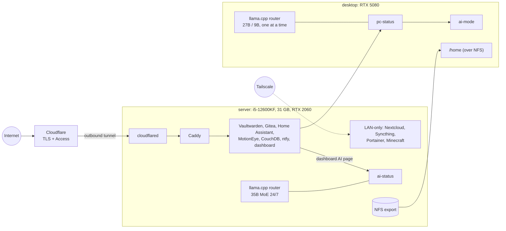

# homelab

*[English version](README.md)*

L'infrastructure de mon serveur maison et de l'IA locale répartie entre ce serveur et mon PC, décrite en code :
des piles Docker Compose derrière Caddy et un tunnel Cloudflare, des routeurs de modèles llama.cpp, et un petit
service HTTP pour les surveiller et les piloter.


## Pourquoi ce dépôt

J'héberge mes propres services à la maison (gestionnaire de mots de passe, Git, domotique, synchronisation des
notes, partage de fichiers, notifications push, un serveur de jeu, un tableau de bord personnel) et je fais
tourner mes propres LLM sur deux GPU. Pendant un temps, tout cela se réglait dans des interfaces web et des
scripts au cas par cas. Ce dépôt en est la version rangée et versionnée : ce qui tourne, comment c'est relié, et
pourquoi c'est fait ainsi. Les secrets, les domaines et les noms de machines sont remplacés par des valeurs
d'exemple.

## Ce qu'il contient

- **14 piles Compose** (`stacks/`) : Caddy, cloudflared, Gitea, Vaultwarden, Home Assistant, ESPHome, MotionEye,
  Nextcloud (+ MariaDB, Redis), CouchDB (Obsidian LiveSync), Syncthing, ntfy (authentification « deny-all »),
  Portainer, un serveur Minecraft moddé, et le tableau de bord personnel (son code est dans un autre dépôt).
- **Routes Caddy** (`caddy/Caddyfile.example`) et **export NFS** du dossier personnel du PC
  (`nfs/exports.example`).
- **IA locale** (`ai/`) :
  - les presets du routeur llama.cpp pour les deux machines : serveur = Qwen3.6-35B-A3B MoE en continu (contexte
    32K, experts en RAM, attention sur une RTX 2060 de 6 Go) + un modèle d'embeddings sur CPU ; PC (RTX 5080,
    16 Go) = un seul modèle à la fois, un 27B seulement en « mode IA », un 9B sinon ;
  - `status.py` : service HTTP d'état et de commande (GPU, modèles chargés, services, chargement/déchargement,
    mode IA), déployé sous le nom `ai-status` sur le serveur et `pc-status` sur le PC ; il a un mode simulé pour la
    démo ;
  - `ai-mode` : libère la VRAM pour le gros modèle en mettant en pause le fond d'écran animé, sérialisé avec
    `flock` ;
  - `claude-local` : lance Claude Code sur le routeur local au lieu de l'API cloud ;
  - `bench.py` : le banc d'essai qui a servi à choisir les modèles (vitesse, appels d'outils, schéma JSON, dérive
    français/anglais) ;
  - `templates/qwen-lenient.jinja` : le template de chat de Qwen, modifié pour accepter des messages système en
    cours de conversation ;
  - `systemd/` : les unités des routeurs et des services d'état.
- **Documentation** : [architecture](docs/architecture.md) (schémas) et [décisions](docs/decisions.md) (notes
  courtes dans l'esprit des ADR : tunnel Cloudflare, ntfy en « deny-all », un modèle à la fois, gestion de la VRAM,
  un MoE sur un petit GPU, NFS en async).

## Architecture



D'autres schémas (réseau, IA, stockage) sont dans [docs/architecture.md](docs/architecture.md).

## Démarrage rapide

### 1. Démo : le service d'état de l'IA, sans GPU

Il faut Python 3.10 ou plus, rien d'autre (bibliothèque standard uniquement).

```sh
python ai/status.py --mock          # or: MOCK_GPU=1 python ai/status.py
# in another terminal
curl -s -H "Authorization: Bearer demo" localhost:8097/status
curl -s -H "Authorization: Bearer demo" -d '{"model": "qwen3.8-27b"}' localhost:8097/llm/load   # refused: AI mode off
curl -s -H "Authorization: Bearer demo" -d '{"on": true}' localhost:8097/ai-mode
curl -s -H "Authorization: Bearer demo" -d '{"model": "qwen3.8-27b"}' localhost:8097/llm/load   # now it fits
```

Le backend simulé renvoie de fausses données de GPU et de modèles, au même format JSON que le vrai, et applique
les mêmes règles que sur le PC : un seul modèle chargé à la fois, et le 27B seulement quand le mode IA est actif.

### 2. Valider les piles

```sh
cp .env.example .env                 # then fill in real values
./scripts/check-compose.sh           # docker compose config -q on every stack
```

### 3. Déployer une pile (sur un vrai serveur)

```sh
cp caddy/Caddyfile.example caddy/Caddyfile            # set your domain
docker compose --env-file .env -f stacks/caddy/compose.yml up -d        # creates caddy-net first
docker compose --env-file .env -f stacks/cloudflared/compose.yml up -d
docker compose --env-file .env -f stacks/gitea/compose.yml up -d
```

Côté IA : copier `ai/presets/*.ini` et `ai/templates/` aux chemins utilisés dans les presets, installer les unités
de `ai/systemd/`, et installer `status.py` sous `~/.local/bin/ai-status` (serveur) ou `pc-status` (PC).

## Configuration

Piles (`.env`, voir `.env.example`) :

| Variable | Utilisée par | Rôle |
|---|---|---|
| `DOMAIN` | Gitea, Vaultwarden | Domaine public (`example.com`) |
| `DATA_ROOT` | la plupart des piles | Disque de données des volumes (`/srv/docker-data`) |
| `NOTES_PATH` | Syncthing, tableau de bord | Dossier des notes Markdown |
| `TZ`, `PUID`, `PGID` | plusieurs | Fuseau horaire, identifiants utilisateur et groupe |
| `CLOUDFLARE_TUNNEL_TOKEN` | cloudflared | Jeton du tunnel (obligatoire) |
| `VAULTWARDEN_ADMIN_TOKEN` | Vaultwarden | Jeton de la page d'administration (obligatoire) |
| `NEXTCLOUD_DB_ROOT_PASSWORD`, `NEXTCLOUD_DB_PASSWORD` | Nextcloud | Mots de passe MariaDB (obligatoires) |
| `COUCHDB_USER`, `COUCHDB_PASSWORD` | CouchDB | Compte administrateur |
| `GITEA_SSH_PORT` | Gitea | Port de l'hôte pour git en SSH (`2222`) |
| `MINECRAFT_EULA`, `MINECRAFT_MEMORY` | Minecraft | Acceptation de l'EULA, taille du tas |

Service d'état (`ai/status.py`, variables d'environnement) :

| Variable | Défaut | Rôle |
|---|---|---|
| `AI_STATUS_ROUTER` | `http://127.0.0.1:8080` | Routeur llama.cpp à interroger |
| `AI_STATUS_KEY_FILE` | `~/.config/llm/api-key` | Clé d'API du routeur, exigée aussi des clients (Bearer) |
| `AI_STATUS_HOST`, `AI_STATUS_PORT` | `0.0.0.0`, `8097` | Adresse d'écoute (`127.0.0.1` en mode simulé) |
| `AI_STATUS_SERVICES` | `llama-router:user` | Unités systemd à surveiller, `nom:user` ou `nom:system` |
| `AI_STATUS_AUTO`, `AI_STATUS_AUTO_AFTER` | `1`, `600` | Mode IA automatique après N secondes d'absence de l'utilisateur |
| `MOCK_GPU` / `--mock` | désactivé | Backend simulé, clé `demo` |

`ai-mode` et `claude-local` lisent `LLM_ROUTER` et `LLM_KEY_FILE` ; `claude-local` lit aussi `CLAUDE_LOCAL_MODEL`.

## Tests

```sh
make test
```

lance `docker compose config -q` sur chaque pile avec `.env.example`, `shellcheck` (image Docker
`koalaman/shellcheck:v0.10.0`) sur les scripts shell, `py_compile` sur les scripts Python, et 19 tests pytest :
l'analyse de la sortie de nvidia-smi et du routeur, la décision du mode IA automatique, l'API HTTP sur le backend
simulé, et `ai-mode` lui-même, exécuté avec des commandes factices dans un dossier d'exécution temporaire. Les
mêmes étapes tournent dans GitHub Actions.

## Arborescence

```
stacks/<service>/compose.yml   one Compose project per service (secrets from .env)
caddy/Caddyfile.example        reverse-proxy routes
nfs/exports.example            NFS export of the desktop home
ai/                            status.py, ai-mode, claude-local, bench.py, presets/, templates/, systemd/
docs/                          architecture.md, decisions.md, screenshot
tests/                         pytest tests
scripts/check-compose.sh       compose validation
```

## État et limites

- C'est une copie nettoyée d'une installation qui tourne, pas un installateur clé en main : les chemins, les
  domaines et les secrets sont des valeurs d'exemple, et certaines piles utilisent encore des images `:latest`,
  comme sur le serveur (les épingler est prévu).
- Les images du tableau de bord personnel (`dashboard`, `dashboard-api`) sont construites depuis un autre dépôt.
- Les parties propres au matériel (service de fond d'écran, économiseur d'écran, Hyprland) ne sont appelées par
  `ai-mode` et `status.py` qu'au travers de commandes ignorées si elles sont absentes ; elles ne sont pas dans ce
  dépôt.
- Sauvegardes : depuis octobre 2026, des instantanés restic chiffrés des données essentielles partent chaque nuit
  vers un stockage objet hors site (hors de ce dépôt) ; les photos et les autres gros médias ne sont pas encore
  couverts.
- Syncthing tourne en root pour lire les données de tous les services ; un utilisateur de sauvegarde dédié, en
  lecture seule, serait plus propre.
- Écrit avec l'aide d'assistants de code IA (Claude Code), utilisés comme j'utiliserais la documentation ou Stack
  Overflow ; je peux expliquer chaque choix de ce dépôt.

## Licence

MIT, voir [LICENSE](LICENSE).
