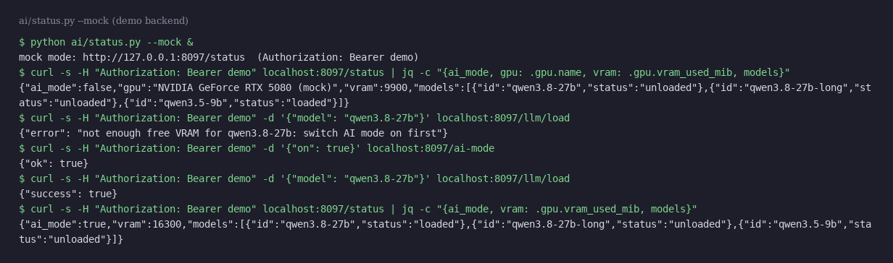
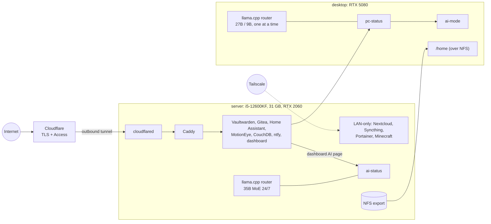

# homelab

Infrastructure-as-code of my home server and of the local AI stack spread over my server and my desktop:
Docker Compose stacks behind Caddy and a Cloudflare Tunnel, plus llama.cpp model routers with a small HTTP
service to watch and drive them.



## Why it exists

I run my own services at home (password manager, Git, home automation, notes sync, file sharing, push
notifications, a game server, a personal dashboard) and my own LLMs on two GPUs. For a while it was configured
through web UIs and ad-hoc scripts. This repository is the cleaned-up, versioned version: what runs, how it is
wired, and why it is done that way. Secrets, domains and machine names are replaced by placeholders.

## What is in it

- **14 Compose stacks** (`stacks/`): Caddy, cloudflared, Gitea, Vaultwarden, Home Assistant, ESPHome, MotionEye,
  Nextcloud (+ MariaDB, Redis), CouchDB (Obsidian LiveSync), Syncthing, ntfy (deny-all auth), Portainer, a modded
  Minecraft server, and the personal dashboard (its code lives in another repository).
- **Caddy routes** (`caddy/Caddyfile.example`) and the **NFS export** of the desktop's home (`nfs/exports.example`).
- **Local AI** (`ai/`):
  - llama.cpp router presets for both machines: server = Qwen3.6-35B-A3B MoE 24/7 (32K context, experts in RAM,
    attention on a 6 GB RTX 2060) + an embedding model on CPU; desktop (RTX 5080 16 GB) = one model at a time,
    a 27B only in "AI mode", a 9B otherwise;
  - `status.py`: HTTP status/control service (GPU, loaded models, services, load/unload, AI mode), deployed as
    `ai-status` on the server and `pc-status` on the desktop; has a mock mode for the demo;
  - `ai-mode`: frees VRAM for the big model by pausing the animated wallpaper, serialized with `flock`;
  - `claude-local`: runs Claude Code against the local router instead of the cloud API;
  - `bench.py`: benchmark used to choose the models (speed, tool calls, JSON schema, French/English drift);
  - `templates/qwen-lenient.jinja`: Qwen chat template patched to accept mid-conversation system messages;
  - `systemd/`: the units for the routers and the status services.
- **Docs**: [architecture](docs/architecture.md) (diagrams) and [decisions](docs/decisions.md) (short ADR-style
  notes: Cloudflare Tunnel, deny-all ntfy, one model at a time, VRAM juggling, MoE on a small GPU, NFS async).

## Architecture



More diagrams (network, AI, storage) in [docs/architecture.md](docs/architecture.md).

## Quick start

### 1. Demo: the AI status service, no GPU needed

Requires Python 3.10+, nothing else (standard library only).

```sh
python ai/status.py --mock          # or: MOCK_GPU=1 python ai/status.py
# in another terminal
curl -s -H "Authorization: Bearer demo" localhost:8097/status
curl -s -H "Authorization: Bearer demo" -d '{"model": "qwen3.8-27b"}' localhost:8097/llm/load   # refused: AI mode off
curl -s -H "Authorization: Bearer demo" -d '{"on": true}' localhost:8097/ai-mode
curl -s -H "Authorization: Bearer demo" -d '{"model": "qwen3.8-27b"}' localhost:8097/llm/load   # now it fits
```

The mock backend serves fake GPU and model data with the same JSON shape as the real one, and keeps the
desktop's rules: one model loaded at a time, the 27B only when AI mode is on.

### 2. Validate the stacks

```sh
cp .env.example .env                 # then fill in real values
./scripts/check-compose.sh           # docker compose config -q on every stack
```

### 3. Deploy a stack (on a real server)

```sh
cp caddy/Caddyfile.example caddy/Caddyfile            # set your domain
docker compose --env-file .env -f stacks/caddy/compose.yml up -d        # creates caddy-net first
docker compose --env-file .env -f stacks/cloudflared/compose.yml up -d
docker compose --env-file .env -f stacks/gitea/compose.yml up -d
```

For the AI side: copy `ai/presets/*.ini` and `ai/templates/` to the paths used in the presets, install the
units from `ai/systemd/`, and `status.py` as `~/.local/bin/ai-status` (server) or `pc-status` (desktop).

## Configuration

Stacks (`.env`, see `.env.example`):

| Variable | Used by | Meaning |
|---|---|---|
| `DOMAIN` | Gitea, Vaultwarden | Public domain (`example.com`) |
| `DATA_ROOT` | most stacks | Data disk for volumes (`/srv/docker-data`) |
| `NOTES_PATH` | Syncthing, dashboard | Markdown notes vault |
| `TZ`, `PUID`, `PGID` | several | Time zone, user/group ids |
| `CLOUDFLARE_TUNNEL_TOKEN` | cloudflared | Tunnel token (required) |
| `VAULTWARDEN_ADMIN_TOKEN` | Vaultwarden | Admin page token (required) |
| `NEXTCLOUD_DB_ROOT_PASSWORD`, `NEXTCLOUD_DB_PASSWORD` | Nextcloud | MariaDB passwords (required) |
| `COUCHDB_USER`, `COUCHDB_PASSWORD` | CouchDB | Admin account |
| `GITEA_SSH_PORT` | Gitea | Host port for git over SSH (`2222`) |
| `MINECRAFT_EULA`, `MINECRAFT_MEMORY` | Minecraft | EULA acceptance, heap size |

Status service (`ai/status.py`, environment):

| Variable | Default | Meaning |
|---|---|---|
| `AI_STATUS_ROUTER` | `http://127.0.0.1:8080` | llama.cpp router to query |
| `AI_STATUS_KEY_FILE` | `~/.config/llm/api-key` | Router API key, also required from clients (Bearer) |
| `AI_STATUS_HOST`, `AI_STATUS_PORT` | `0.0.0.0`, `8097` | Listen address (`127.0.0.1` in mock mode) |
| `AI_STATUS_SERVICES` | `llama-router:user` | systemd units to report, `name:user` or `name:system` |
| `AI_STATUS_AUTO`, `AI_STATUS_AUTO_AFTER` | `1`, `600` | Automatic AI mode after N seconds of user absence |
| `MOCK_GPU` / `--mock` | off | Fake backend, key `demo` |

`ai-mode` and `claude-local` read `LLM_ROUTER` and `LLM_KEY_FILE`; `claude-local` also `CLAUDE_LOCAL_MODEL`.

## Tests

```sh
make test
```

runs `docker compose config -q` on every stack with `.env.example`, `shellcheck` (Docker image
`koalaman/shellcheck:v0.10.0`) on the shell scripts, `py_compile` on the Python scripts, and 19 pytest tests:
nvidia-smi and router parsing, the automatic AI-mode decision, the HTTP API on the mock backend, and `ai-mode`
itself run with stub commands in a temporary runtime directory. The same steps run in GitHub Actions.

## Project layout

```
stacks/<service>/compose.yml   one Compose project per service (secrets from .env)
caddy/Caddyfile.example        reverse-proxy routes
nfs/exports.example            NFS export of the desktop home
ai/                            status.py, ai-mode, claude-local, bench.py, presets/, templates/, systemd/
docs/                          architecture.md, decisions.md, screenshot
tests/                         pytest tests
scripts/check-compose.sh       compose validation
```

## Status / limits

- This is a sanitized copy of a running setup, not a turnkey installer: paths, domains and secrets are
  placeholders, and some stacks still use `:latest` images as on the live server (pinning them is on the list).
- The personal dashboard's images (`dashboard`, `dashboard-api`) are built from a separate repository.
- Hardware-specific parts (wallpaper service, screensaver, Hyprland) are only referenced by `ai-mode` and
  `status.py` through commands that are skipped when absent; they are not in this repository.
- Backups: the data directory is shared as a Syncthing folder and the notes vault is committed to Gitea; there is no off-site,
  versioned backup with tested restores yet.
- Syncthing runs as root to read every service's data; a dedicated read-only backup user would be cleaner.
- Built with the help of AI coding assistants (Claude Code), used the way I would use documentation and
  Stack Overflow; I can explain every design choice in this repository.

## Licence

MIT, see [LICENSE](LICENSE).
