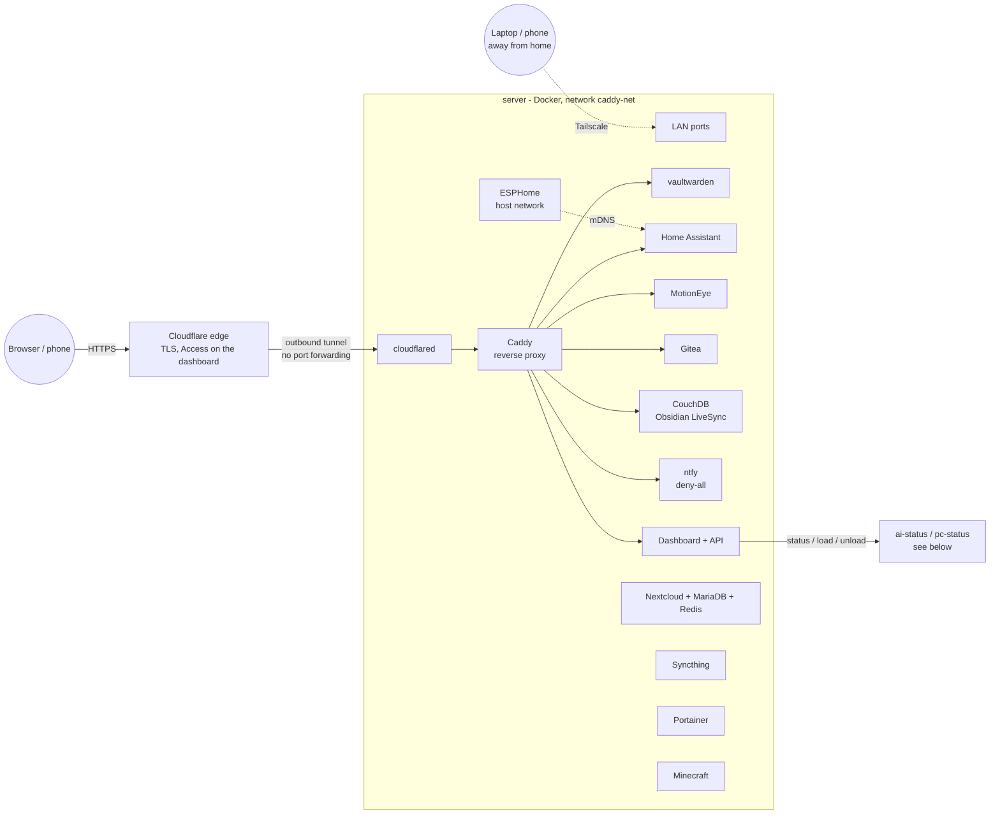
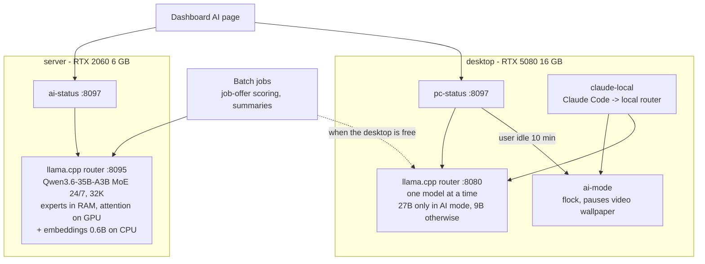
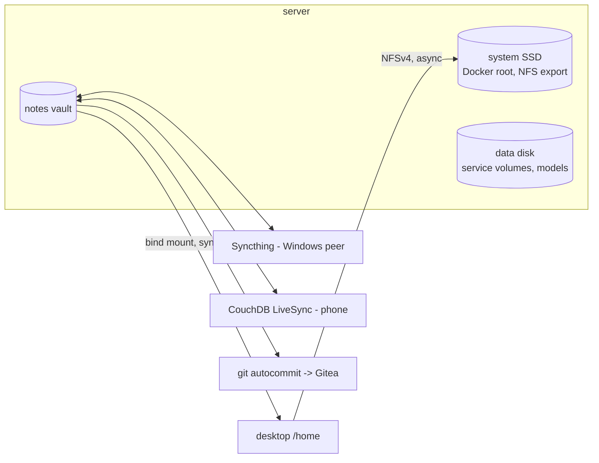

# Architecture

Two machines on the same LAN:

- **server**: always on. Arch Linux, Intel i5-12600KF, 31 GB RAM, RTX 2060 6 GB. Runs about 30 Docker
  containers, the server-side LLM router, and exports the desktop's home directory over NFS.
- **desktop**: the daily workstation and gaming PC, RTX 5080 16 GB. Its `/home` is mounted from the server; it runs
  its own LLM router for the big model when it is not busy.

## Network and services

Notes:
- Only Caddy is on the path from the Internet; every web service joins the external `caddy-net` network created
  by the Caddy stack and is addressed by container name.
- Portainer, Syncthing's UI, Nextcloud and the Minecraft server are reached on the LAN or through Tailscale,
  not through the tunnel.
- The dashboard is protected by Cloudflare Access (one-time code by e-mail) before traffic even reaches the tunnel.

## Local AI on two machines

- Both routers are `llama-server` in router mode (`--models-preset presets.ini`): one HTTP endpoint, models
  loaded and unloaded by name, OpenAI-compatible `/v1/chat/completions` and Anthropic-compatible `/v1/messages`.
- `ai-status` and `pc-status` are the same script (`ai/status.py`), configured by environment variables.
- `ai-mode` exists only on the desktop; on the server `/ai-mode` returns 404 and `ai_mode` is `null`.

## Storage

Apps that keep many small files or SQLite/flock state (Steam, Flatpak data, browser cache) live on the desktop's
local disk with a symlink, not on the NFS home.
